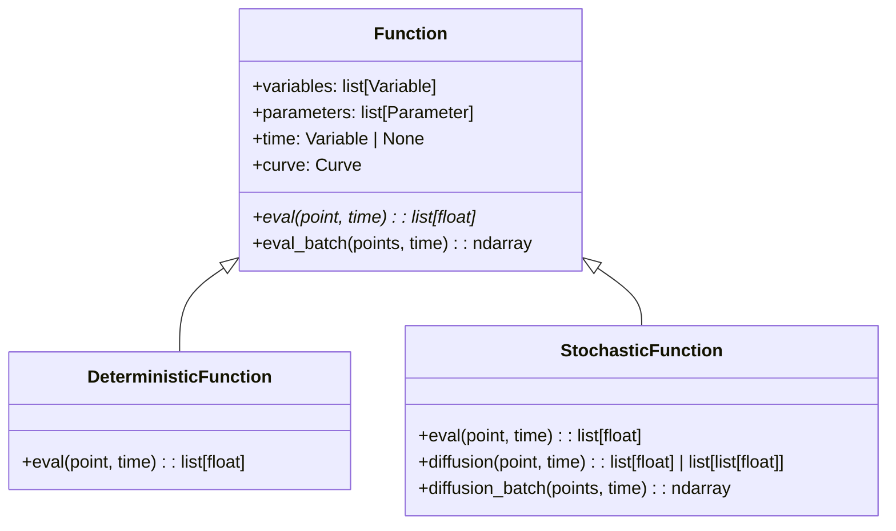

# FUNCTION

## Overview

The `function` submodule provides the abstract base classes and concrete implementations for defining differential equation functions. It establishes a clean hierarchy for both deterministic and stochastic differential equations.

## Architecture

```
Function (Abstract Base)
├── DeterministicFunction (ODEs)
└── StochasticFunction (SDEs)
```

## Class Hierarchy

### Function (base class)

`Function(variables, parameters, results, time=None)` holds the state variables,
the parameters, the result variables and an optional time variable. Its `eval(point,
time)` raises `NotImplementedError`; a subclass returns the field there. `eval_batch`
evaluates many points at once, by default one `eval` per row.

```python
import numpy as np

from discrecontinual_equations.function.function import Function
from discrecontinual_equations.parameter import Parameter
from discrecontinual_equations.variable import Variable

base = Function(
    variables=[Variable(name="x")],
    parameters=[Parameter(name="k", value=1.0)],
    results=[Variable(name="x'")],
)
print([v.name for v in base.variables], [p.value for p in base.parameters], base.time)
try:
    base.eval([1.0])
except NotImplementedError:
    print("Function.eval is for subclasses to implement")
```

### DeterministicFunction

`DeterministicFunction` is the right-hand side `f(t, y)` of an ODE. The deterministic
solvers call only its `eval`, which returns one derivative per state variable. It
has no `diffusion`.

### StochasticFunction

`StochasticFunction` is an SDE: `eval` is the drift `μ(x, t)` and `diffusion` the
noise amplitude `σ(x, t)`. `diffusion` returns either one coefficient per component
(diagonal noise) or an `n x m` nested list (a full matrix with `m` independent
drivers); the solvers read the shape. A subclass may set the class attribute
`diagonal_noise = True` to promise that `b_i` depends on `x_i` alone, which lets the
solvers read every slope from two evaluations. `eval_batch` and `diffusion_batch`
evaluate many points at once for the ensemble solver.

## UML Design



## Usage Examples

### Ordinary Differential Equations

```python
from discrecontinual_equations.function.deterministic import DeterministicFunction
from discrecontinual_equations.parameter import Parameter
from discrecontinual_equations.variable import Variable


class ExponentialDecay(DeterministicFunction):
    """ODE: dx/dt = -k*x"""

    def eval(self, point: list[float], time: float | None = None) -> list[float]:
        x = point[0]  # Current value
        k = self.parameters[0].value  # Decay constant
        return [-k * x]  # Derivative


# Usage
x = Variable(name="Concentration", abbreviation="x")
k = Parameter(name="Rate constant", value=0.1)

decay = ExponentialDecay(variables=[x], parameters=[k], results=[Variable(name="x'")])
result = decay.eval([1.0])
print(result)  # [-0.1] for x=1, k=0.1
```

### Stochastic Differential Equations

```python
from discrecontinual_equations.function.stochastic import StochasticFunction
from discrecontinual_equations.parameter import Parameter
from discrecontinual_equations.variable import Variable


class OrnsteinUhlenbeck(StochasticFunction):
    """SDE: dX = -αX dt + σ dW (mean-reverting process)"""

    def eval(self, point: list[float], time: float | None = None) -> list[float]:
        """Drift term: μ(x,t) = -αx"""
        x = point[0]
        alpha = self.parameters[0].value  # Mean reversion rate
        return [-alpha * x]

    def diffusion(self, point: list[float], time: float | None = None) -> list[float]:
        """Diffusion term: σ(x,t) = σ"""
        sigma = self.parameters[1].value  # Volatility
        return [sigma]


# Usage
x = Variable(name="Position", abbreviation="x")
alpha = Parameter(name="Mean reversion", value=1.0)
sigma = Parameter(name="Volatility", value=0.5)

ou_process = OrnsteinUhlenbeck(
    variables=[x], parameters=[alpha, sigma], results=[Variable(name="dX")]
)
drift = ou_process.eval([2.0])
diffusion = ou_process.diffusion([2.0])
print(drift, diffusion)  # [-2.0] [0.5]
```

## Calculus Support for SDEs

Stochastic functions support both Ito and Stratonovich calculus interpretations:

**Ito Calculus**: Standard interpretation `dX = μ(X,t)dt + σ(X,t)dW`
- Used in mathematical finance and stochastic analysis
- Corresponds to limit of discrete approximations

**Stratonovich Calculus**: Symmetric interpretation `dX = μ(X,t)dt + σ(X,t) ∘ dW`
- Natural for physical systems
- Equivalent to the Ito equation with drift `μ + (1/2)σ∂σ/∂x` and the same `σ`

The stochastic solvers take `calculus="stratonovich"` in their config and add that
correction to the drift themselves.

## Key Features

- **Type Safety**: Clear distinction between deterministic and stochastic functions
- **Calculus Support**: Full Ito/Stratonovich calculus for SDEs
- **Extensible**: Easy to implement custom ODE/SDE functions
- **Plain classes**: a function is an ordinary Python class; `Variable` and `Parameter` are the Pydantic models
- **Documented**: Comprehensive docstrings with usage examples

## Integration with Solvers

Functions are used by solvers to compute derivatives at each integration step:

```python
from discrecontinual_equations.function.stochastic import StochasticFunction

# What a fixed-step solver does with a function, one Euler step at a time
state, step = [2.0], 0.1
for time_step in [0.0, 0.1, 0.2]:
    derivative_values = ou_process.eval(state, time_step)
    if isinstance(ou_process, StochasticFunction):
        diffusion_values = ou_process.diffusion(state, time_step)  # times dW in an SDE step
    state = [s + step * d for s, d in zip(state, derivative_values, strict=True)]
print(state)  # the deterministic part only: 2 * 0.9**3
```

## Error Handling

Functions should validate their inputs and raise appropriate exceptions:

```python
class CheckedDecay(ExponentialDecay):
    def eval(self, point: list[float], time: float | None = None) -> list[float]:
        if len(point) != len(self.variables):
            raise ValueError(f"Expected {len(self.variables)} values, got {len(point)}")
        return super().eval(point, time)


checked = CheckedDecay(variables=[x], parameters=[k], results=[Variable(name="x'")])
try:
    checked.eval([1.0, 2.0])
except ValueError as error:
    print(error)  # Expected 1 values, got 2
```

## Performance Considerations

- Functions are called repeatedly during integration
- Keep evaluations efficient for long simulations
- Cache expensive computations when possible
- Use vectorized operations for multiple variables

---

**Parent Module:** [DISCRECONTINUAL_EQUATIONS](../DISCRECONTINUAL_EQUATIONS.md)

**Related Modules:**
- [SOLVER](../solver/SOLVER.md) - Uses functions for derivative evaluation
