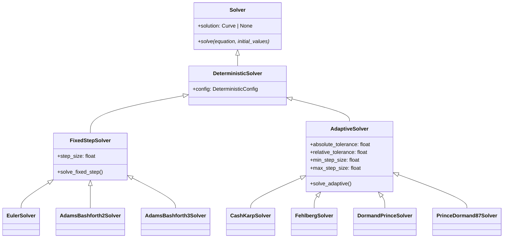
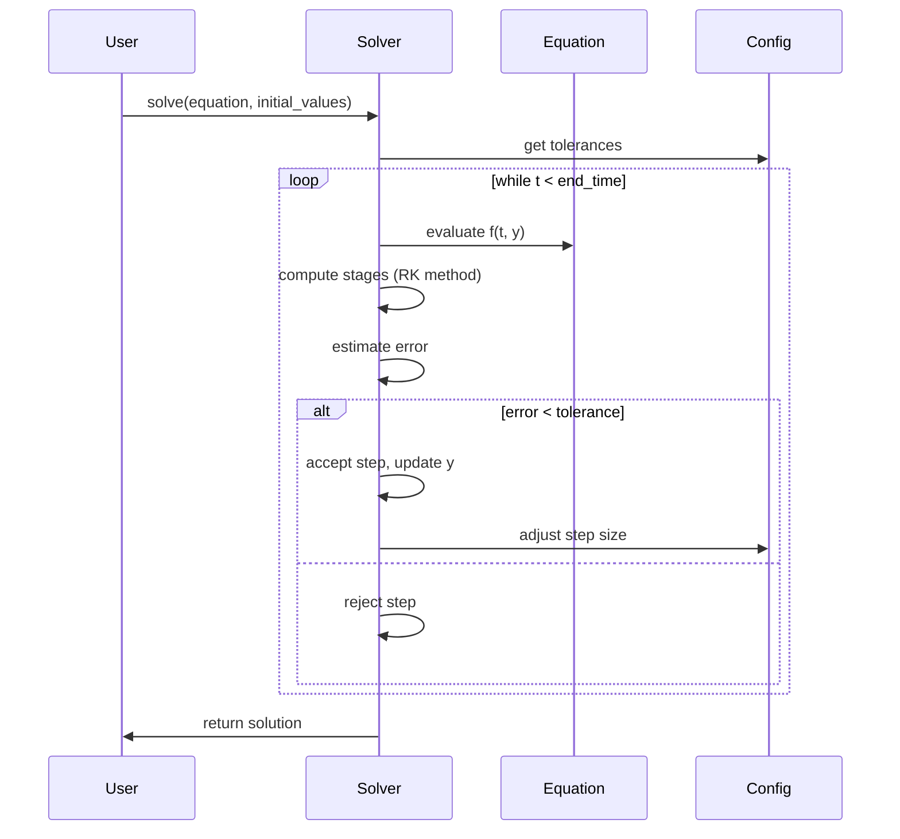

# DETERMINISTIC

## Overview

The `deterministic` submodule provides numerical algorithms for solving ordinary differential equations (ODEs) using deterministic methods. This includes fixed-step and adaptive-step Runge-Kutta methods optimized for systems without stochastic noise.

## Architecture

```
Deterministic Solvers
├── EulerSolver - Basic first-order method
├── AdamsBashforth2Solver - 2nd order multistep
├── AdamsBashforth3Solver - 3rd order multistep
├── CashKarpSolver - 4th/5th order adaptive RK
├── FehlbergSolver - 4th/5th order adaptive RK
├── DormandPrinceSolver - 5th/4th order adaptive RK
└── PrinceDormand87Solver - 8th order adaptive RK, 7th-order error estimate (DormandPrince89Solver is a deprecated alias)
```

## Executive Summary

**Purpose**: Solve deterministic ODE systems with high accuracy and efficiency
**Key Features**: Multiple integration orders, adaptive step sizing, error control
**Performance**: Excellent for smooth, non-stiff ODE systems
**Use Cases**: Physics simulations, chemical kinetics, control systems

## Core Classes

### EulerSolver

```python
from discrecontinual_equations.solver.solver import Solver
from discrecontinual_equations.solver.deterministic.euler.euler_solver import EulerSolver

# A Solver: built from an EulerConfig, solve(equation, initial_values) -> Curve.
assert issubclass(EulerSolver, Solver)
```

### Adaptive Solvers

All adaptive solvers inherit from `EmbeddedRungeKuttaSolver` (`embedded_runge_kutta.py`), which takes the trial step, measures the error (`error_ratio`) and sets the next step (`accepted_step_size`, `rejected_step_size`):

```python
from discrecontinual_equations.solver.deterministic.dormand_prince.dormand_prince_config import DormandPrinceConfig
from discrecontinual_equations.solver.deterministic.dormand_prince.dormand_prince_solver import DormandPrinceSolver
from discrecontinual_equations.solver.deterministic.embedded_runge_kutta import EmbeddedRungeKuttaSolver

solver = DormandPrinceSolver(DormandPrinceConfig())
assert isinstance(solver, EmbeddedRungeKuttaSolver)
# The subclass names its tableau; the base class steps, measures and controls.
print(solver.tableau.stages, solver.tableau.error_order)  # 7 4
print(f"{solver.controller_exponent:.2f}")  # alpha = 1/5 - 0.75 * 0.04 = 0.17
```

## UML Class Diagram



## Sequence Diagram - Adaptive Solving



## Folder Structure

```
deterministic/
├── __init__.py
├── DETERMINISTIC.md
├── euler/
│   ├── __init__.py
│   ├── euler_config.py
│   └── euler_solver.py
├── adams_bashforth2/
│   ├── __init__.py
│   ├── adams_bashforth2_config.py
│   └── adams_bashforth2_solver.py
├── adams_bashforth3/
│   ├── __init__.py
│   ├── adams_bashforth3_config.py
│   └── adams_bashforth3_solver.py
├── cash_karp/
│   ├── __init__.py
│   ├── cash_karp_config.py
│   └── cash_karp_solver.py
├── fehlberg/
│   ├── __init__.py
│   ├── fehlberg_config.py
│   └── fehlberg_solver.py
├── dormand_prince/
│   ├── __init__.py
│   ├── dormand_prince_config.py
│   └── dormand_prince_solver.py
└── prince_dormand87/
    ├── __init__.py
    ├── prince_dormand87_config.py
    └── prince_dormand87_solver.py
```

## Examples

### Basic ODE Solution

```python
from discrecontinual_equations.differential_equation import DifferentialEquation
from discrecontinual_equations.function.deterministic import DeterministicFunction
from discrecontinual_equations.solver.deterministic.euler.euler_config import EulerConfig
from discrecontinual_equations.solver.deterministic.euler.euler_solver import EulerSolver
from discrecontinual_equations.variable import Variable


# Define dy/dt = -y
class Decay(DeterministicFunction):
    def eval(self, point, time=None):
        return [-point[0]]


# Setup and solve
y, t = Variable(name="y"), Variable(name="t")
decay = Decay([y], [], [Variable(name="dy")], t)
equation = DifferentialEquation(variables=[y], time=t, parameters=[], derivative=decay)

config = EulerConfig(start_time=0, end_time=5, step_size=0.1)
solver = EulerSolver(config)
solver.solve(equation, [1.0])
```

### Adaptive Solving with Error Control

```python
config = DormandPrinceConfig(
    start_time=0, end_time=10,
    initial_step_size=0.1,
    absolute_tolerance=1e-8,
    relative_tolerance=1e-6,
)

solver = DormandPrinceSolver(config)
curve = solver.solve(equation, [1.0])
print(len(curve) - 1, "accepted steps")  # 39 accepted steps
```

## Functionality Explanation

### Fixed-Step Methods
- **Euler**: Simple forward difference, O(h) accuracy
- **Adams-Bashforth**: Linear multistep methods using previous values
- **Advantage**: Predictable computation time, simple implementation
- **Limitation**: Fixed accuracy regardless of problem stiffness

### Adaptive Methods
- **Embedded RK Pairs**: Simultaneously compute two approximations
- **Error Estimation**: Difference gives local truncation error
- **Step Adjustment**: PI controller optimizes step size
- **Advantage**: Automatic accuracy control, efficient for varying stiffness

### Error Control Algorithm

```text
ratio = sqrt(mean((err_i / (atol + rtol * max(|y_i|, |y_new_i|)))^2))   # RMS norm
alpha = 1/q - 0.75 * beta          # q = order of the error estimate + 1

if ratio <= 1:
    accept the step
    h_new = h * clip(safety * ratio^(-alpha) * ratio_old^beta, 0.2, 10)   # PI control
else:
    reject the step
    h_new = h * max(0.2, safety * ratio^(-alpha))
```

## Performance Characteristics

| Method | Order | Stages/Step | Adaptive | Relative Speed |
|--------|-------|-------------|----------|----------------|
| Euler | 1 | 1 | No | Fastest |
| Adams-Bashforth 2 | 2 | 1 | No | Fast |
| Adams-Bashforth 3 | 3 | 1 | No | Fast |
| Cash-Karp | 4/5 | 6 | Yes | Medium |
| Fehlberg | 4/5 | 6 | Yes | Medium |
| Dormand-Prince | 5/4 | 7 | Yes | Medium |
| Prince-Dormand 8(7) | 8/7 | 13 | Yes | Slowest |

## References

- Hairer, E., et al. (1993). *Solving Ordinary Differential Equations I*
- Press, W.H., et al. (1992). *Numerical Recipes in C*
- Shampine, L.F. (1994). *The MATLAB ODE Suite*

---

**Parent Module:** [SOLVER](../SOLVER.md)

**Child Modules:**
- [EULER](euler/EULER.md)
- [ADAMS_BASHFORTH2](adams_bashforth2/ADAMS_BASHFORTH2.md)
- [`AdamsBashforth3Solver`](adams_bashforth3/adams_bashforth3_solver.py)
- [`CashKarpSolver`](cash_karp/cash_karp_solver.py)
- [`FehlbergSolver`](fehlberg/fehlberg_solver.py)
- [`DormandPrinceSolver`](dormand_prince/dormand_prince_solver.py)
- [`PrinceDormand87Solver`](prince_dormand87/prince_dormand87_solver.py)

The solvers with no design page of their own link to their source; their
docstrings, and the [deterministic solvers guide](../../../docs/user-guide/deterministic-solvers.md),
document them.
