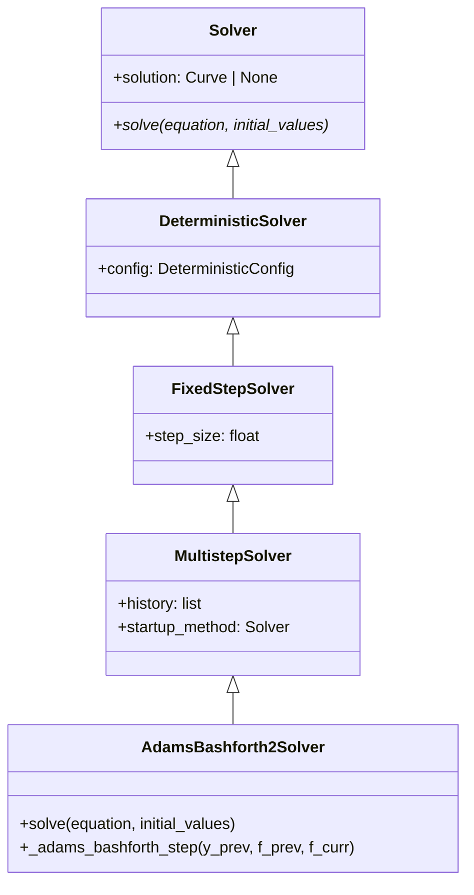
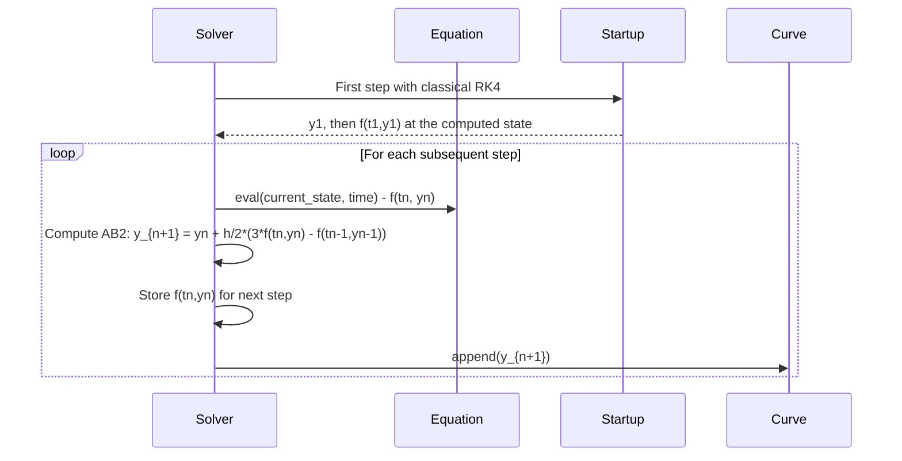

# ADAMS_BASHFORTH2

## Overview

The Adams-Bashforth 2 method is a second-order linear multistep method for solving ordinary differential equations. It uses information from the current and previous time steps to achieve higher accuracy than single-step methods like Euler.

## Architecture

```
AdamsBashforth2Solver
├── Config: start_time, end_time, step_size
├── Method: 2-step linear multistep (Adams-Bashforth)
├── Order: 2nd order, O(h²)
└── Startup: one classical Runge-Kutta (RK4) step (DEQ-141)
```

## Executive Summary

**Purpose**: Higher-accuracy ODE solver with multistep approach
**Key Features**: Uses previous step information, 2nd order accuracy, efficient for smooth problems
**Performance**: Good balance of accuracy and computational cost
**Use Cases**: Smooth ODEs, long-time integration, physics simulations

## Core Classes

### AdamsBashforth2Config

```python
from discrecontinual_equations.solver.solver_config import DeterministicConfig
from discrecontinual_equations.solver.deterministic.adams_bashforth2.adams_bashforth2_config import AdamsBashforth2Config

# A fixed grid: start_time, end_time and a step that divides the interval.
config = AdamsBashforth2Config(start_time=0.0, end_time=1.0, step_size=0.25)
assert isinstance(config, DeterministicConfig)
print(config.times.tolist())  # [0.0, 0.25, 0.5, 0.75, 1.0]
```

### AdamsBashforth2Solver

```python
from discrecontinual_equations.solver.deterministic.adams_bashforth import AdamsBashforthSolver
from discrecontinual_equations.solver.deterministic.adams_bashforth2.adams_bashforth2_solver import AdamsBashforth2Solver

# The shared k-step solver does the work; this class names its weights.
assert issubclass(AdamsBashforth2Solver, AdamsBashforthSolver)
print(AdamsBashforth2Solver.weights)  # (1.5, -0.5): newest derivative first
```

## UML Class Diagram



## Sequence Diagram - Adams-Bashforth 2



## Folder Structure

```
adams_bashforth2/
├── __init__.py
├── adams_bashforth2_config.py
├── adams_bashforth2_solver.py
└── ADAMS_BASHFORTH2.md
```

## Examples

### Population Growth

```python
import math

from discrecontinual_equations.differential_equation import DifferentialEquation
from discrecontinual_equations.function.deterministic import DeterministicFunction
from discrecontinual_equations.parameter import Parameter
from discrecontinual_equations.variable import Variable


# Logistic growth: dP/dt = r*P*(1 - P/K)
class LogisticGrowth(DeterministicFunction):
    def eval(self, point, time=None):
        P = point[0]
        r = self.parameters[0].value  # growth rate
        K = self.parameters[1].value  # carrying capacity
        return [r * P * (1 - P / K)]


P, t = Variable(name="P"), Variable(name="t")
r, K = Parameter(value=0.5, name="r"), Parameter(value=100.0, name="K")
growth = LogisticGrowth([P], [r, K], [Variable(name="dP")], t)
equation = DifferentialEquation(variables=[P], time=t, parameters=[r, K], derivative=growth)

config = AdamsBashforth2Config(start_time=0, end_time=20, step_size=0.1)
curve = AdamsBashforth2Solver(config).solve(equation, [1.0])  # Start with 1 individual
exact = 100.0 / (1.0 + 99.0 * math.exp(-0.5 * 20))
print(f"P(20) = {curve.results[0].discretization[-1]:.4f}, exact {exact:.4f}")
# P(20) = 99.5507, exact 99.5526
```

### Damped Harmonic Oscillator

```python
# d²x/dt² + γ dx/dt + ω²x = 0
class DampedOscillator(DeterministicFunction):
    def eval(self, point, time=None):
        x, v = point  # position, velocity
        gamma = self.parameters[0].value  # damping
        omega = self.parameters[1].value  # frequency
        return [v, -gamma * v - omega**2 * x]


x, v = Variable(name="x"), Variable(name="v")
gamma, omega = Parameter(value=0.2, name="gamma"), Parameter(value=1.0, name="omega")
oscillator = DampedOscillator([x, v], [gamma, omega], [Variable(name="dx"), Variable(name="dv")], t)
equation = DifferentialEquation(
    variables=[x, v], time=t, parameters=[gamma, omega], derivative=oscillator
)

config = AdamsBashforth2Config(start_time=0, end_time=20, step_size=0.01)
curve = AdamsBashforth2Solver(config).solve(equation, [1.0, 0.0])  # x=1, v=0
print(f"x(20) = {curve.results[0].discretization[-1]:.4f}")  # x(20) = 0.0790
```

## Functionality Explanation

### Mathematical Foundation

The Adams-Bashforth 2 method uses the formula:

```
y_{n+1} = y_n + (h/2) * (3*f(t_n, y_n) - f(t_{n-1}, y_{n-1}))
```

This is derived from the Newton backward difference interpolation of the integral form of the ODE.

### Multistep Nature

- **Requires startup**: the first step is a classical fourth-order Runge-Kutta step giving y₁; the stored derivative for node 1 is f(t₁, y₁) (DEQ-141; until then an Euler step and f(t₁, y₀))
- **History dependence**: Uses information from previous step
- **Memory efficient**: Only stores one previous function value

### Convergence Properties

- **Order**: 2nd order - `|y(t) - ŷ(t)| = O(h²)`
- **Local Error**: O(h³) per step
- **Global Error**: O(h²) over the interval
- **Zero-stable**: Method is zero-stable

## Algorithm Details

### Startup Phase

The solver's loop lives in `adams_bashforth.AdamsBashforthSolver.solve`; this continues the logistic example and rebuilds it by hand.

```python
import numpy as np

from discrecontinual_equations.solver.deterministic.adams_bashforth import (
    classical_runge_kutta_step,
)

# The same method by hand, on the logistic equation: one classical Runge-Kutta
# step to start, because AB2 needs two derivatives to begin.
h, times = 0.1, [0.1 * n for n in range(201)]
f = lambda y, time: np.array(growth.eval(point=list(y), time=time))
logistic = DifferentialEquation(variables=[P], time=t, parameters=[r, K], derivative=growth)
y = [np.array([1.0])]
y.append(classical_runge_kutta_step(logistic, times[0], y[0], h))
```

### Adams-Bashforth 2 Step

```python
# Then y_{n+1} = y_n + (h/2) * (3 f_n - f_{n-1}) on the rest of the grid.
for n in range(1, len(times) - 1):
    y.append(y[n] + h / 2 * (3 * f(y[n], times[n]) - f(y[n - 1], times[n - 1])))

solved = AdamsBashforth2Solver(AdamsBashforth2Config(start_time=0, end_time=20, step_size=0.1))
by_solver = solved.solve(logistic, [1.0]).results[0].discretization
print(max(abs(a[0] - b) for a, b in zip(y, by_solver)) < 1e-12)  # True: agrees to rounding
```

## Error Analysis

### Local Truncation Error

The LTE for Adams-Bashforth 2 is:
```
τ_{n+1} = - (5/12) h³ y'''(t_n) + O(h⁴)
```

### Global Error Accumulation

For smooth problems with bounded derivatives:
```
|y(t_N) - ŷ(t_N)| ≤ C h²
```

Where C depends on the problem's smoothness.

## Performance Characteristics

| Method | Order | Steps/Function Call | Stability | Memory |
|--------|-------|-------------------|-----------|--------|
| Euler | 1 | 1 | Limited | O(1) |
| AB2 | 2 | 1 | Good | O(1) |
| RK4 | 4 | 4 | Excellent | O(1) |

## Applications

### Physics and Engineering
- **Orbital mechanics**: Satellite trajectories
- **Circuit analysis**: RLC circuit simulation
- **Structural dynamics**: Building response analysis

### Biology and Chemistry
- **Population models**: Predator-prey systems
- **Chemical kinetics**: Reaction rate equations
- **Epidemiology**: Disease spread models

### Control Systems
- **Linear systems**: State space representations
- **Feedback control**: System response analysis
- **Stability analysis**: Lyapunov function evaluation

## Limitations

### Startup Issues
- **First step accuracy**: Depends on startup method
- **Warm-up period**: One step of reduced accuracy

### Stability Considerations
- **Nonlinear problems**: May require smaller steps than predicted
- **Stiff systems**: Less stable than implicit methods

## References

- Adams, John Couch (1855). "On the correction of the aberrations of the planets"
- Bashforth, Francis (1883). "An Attempt to test the Theories of Capillary Action"
- Lambert, J.D. (1973). "Computational Methods in Ordinary Differential Equations"

---

**Parent Module:** [DETERMINISTIC](../DETERMINISTIC.md)

**Related Modules:**
- [EULER](../euler/EULER.md) - Single-step method for startup
- [`AdamsBashforth3Solver`](../adams_bashforth3/adams_bashforth3_solver.py) - Higher-order Adams method
