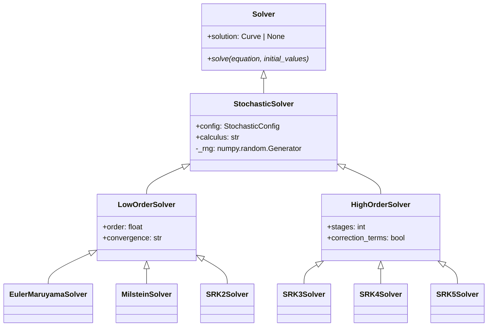
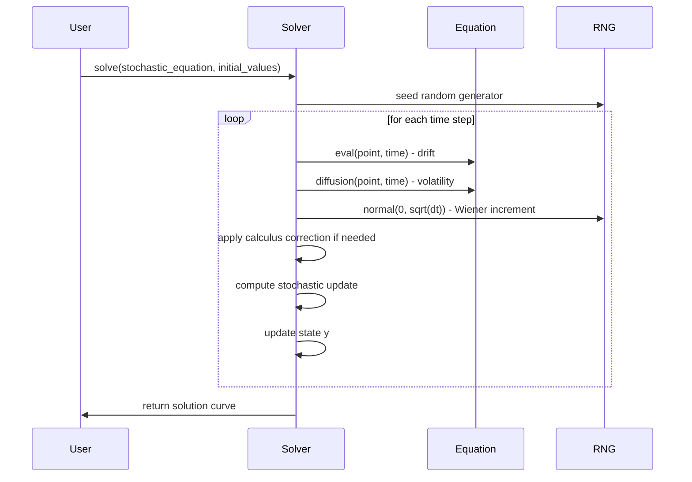

# STOCHASTIC

## Overview

The `stochastic` submodule provides numerical algorithms for solving stochastic differential equations (SDEs) with support for both Ito and Stratonovich calculus interpretations. This includes methods ranging from basic Euler-Maruyama to high-order Stochastic Runge-Kutta schemes.

## Architecture

```
Stochastic Solvers
├── EulerMaruyamaSolver - Strong order 0.5, weak order 1.0
├── MilsteinSolver - Strong order 1.0, weak order 1.0
├── SRK2Solver - Strong order 1.0, weak order 1.0 (Kloeden-Platen 11.1.7, measured)
├── SRK3Solver - Strong order 1.5, scalar or several channels (Kloeden-Platen 11.2.1; DEQ-66)
├── SRK4Solver - Weak order 2.0, strong order 1.0, scalar noise (Kloeden-Platen 15.1.4, measured)
├── SRK5Solver - Refuses to run; no scheme of the claimed order exists (DEQ-25)
├── GottwaldMelbourneSolver - Deterministic homogenisation for α-stable SDEs
└── ZhanDuanLiLiSolver - Zhan-Duan-Li-Li method for SDEs
```

## Executive Summary

**Purpose**: Solve SDE systems with stochastic noise and calculus interpretation support
**Key Features**: Multiple convergence orders, Ito/Stratonovich calculus, reproducible simulations
**Performance**: Specialized for stochastic processes with Wiener increments
**Use Cases**: Financial modeling, physical systems with noise, population dynamics

## Core Classes

### Base Stochastic Solver

```python
class StochasticSolver(Solver):
    """Base class for stochastic differential equation solvers."""

    def __init__(self, solver_config: StochasticConfig):
        """Initialize with random seed support."""

    def _generate_wiener_increment(self, dt: float) -> float:
        """Generate N(0, dt) Wiener increment."""
```

### Calculus Support

All stochastic solvers support calculus selection:

```python
class StochasticConfig(SolverConfig):
    """Configuration with calculus interpretation."""

    calculus: Literal["ito", "stratonovich"] = "ito"

    def apply_calculus_correction(self, drift, diffusion) -> tuple:
        """Apply Ito ↔ Stratonovich conversion if needed."""
```

## UML Class Diagram



## Sequence Diagram - SDE Solving



## Folder Structure

```
stochastic/
├── __init__.py
├── STOCHASTIC.md
├── euler_maruyama/
│   ├── __init__.py
│   ├── euler_maruyama_config.py
│   ├── euler_maruyama_solver.py
│   └── EULER_MARUYAMA.md
├── milstein/
│   ├── __init__.py
│   ├── milstein_config.py
│   ├── milstein_solver.py
│   └── MILSTEIN.md
├── srk2/
│   ├── __init__.py
│   ├── srk2_config.py
│   ├── srk2_solver.py
│   └── SRK2.md
├── srk3/
│   ├── __init__.py
│   ├── srk3_config.py
│   ├── srk3_solver.py
│   └── SRK3.md
├── srk4/
│   ├── __init__.py
│   ├── srk4_config.py
│   ├── srk4_solver.py
│   └── SRK4.md
├── srk5/
│   ├── __init__.py
│   ├── srk5_config.py
│   ├── srk5_solver.py
│   └── SRK5.md
├── gottwald_melbourne/
│   ├── __init__.py
│   ├── gottwald_melbourne_config.py
│   ├── gottwald_melbourne_solver.py
│   └── GOTTWALD_MELBOURNE.md
└── zhan_duan_li_li/
    ├── __init__.py
    ├── zhan_duan_li_li_config.py
    ├── zhan_duan_li_li_solver.py
    └── ZHAN_DUAN_LI_LI.md
```

## Examples

### Basic SDE Solution

```python
from discrecontinual_equations.solver.stochastic.euler_maruyama import EulerMaruyamaConfig, EulerMaruyamaSolver

# Geometric Brownian motion: dX = μX dt + σX dW
class GBM(StochasticFunction):
    def eval(self, point, time=None):
        x, mu, sigma = point[0], self.parameters[0].value, self.parameters[1].value
        return [mu * x]  # Drift

    def diffusion(self, point, time=None):
        x, sigma = point[0], self.parameters[1].value
        return [sigma * x]  # Volatility

# Solve with Ito calculus
config = EulerMaruyamaConfig(
    start_time=0, end_time=1, step_size=0.01,
    calculus="ito", random_seed=42
)
solver = EulerMaruyamaSolver(config)
solver.solve(equation, [100.0])  # Start at $100
```

### High-Order Stochastic Solving

```python
from discrecontinual_equations.solver.stochastic.srk4 import SRK4Config, SRK4Solver

# Use SRK4 for weak order 2.0 (expectations); SRK3 for strong order 1.5 (paths)
config = SRK4Config(
    start_time=0, end_time=1, step_size=0.001,
    calculus="stratonovich", random_seed=123
)

solver = SRK4Solver(config)
solver.solve(stochastic_equation, [1.0])
```

## Functionality Explanation

### Convergence Orders
- **Strong Order**: Convergence of solution paths
- **Weak Order**: Convergence of expected values
- **Trade-off**: Higher orders require more function evaluations

### Calculus Interpretations

**Ito SDEs**: `dX = μ(X,t)dt + σ(X,t)dW`
- Standard in mathematical finance
- Corresponds to limit of discrete approximations

**Stratonovich SDEs**: `dX = μ(X,t)dt + σ(X,t) ∘ dW`
- Equivalent to Ito with modified drift: `μ_corrected = μ + (1/2)σ∂σ/∂x` (added, never subtracted: DEQ-27)
- Natural for physical systems

### Wiener Process Generation

Each solver owns a `numpy.random.default_rng(random_seed)` generator, or takes a
`WienerSource` of the caller's (a `BrownianPath` fixed in advance is what a
convergence study needs), and draws one `N(0, dt)` increment per noise channel
and step. The global stream is never seeded: `np.random.seed` would let one
solver alter another's results (DEQ-22). The channel count is the number of
drivers the diffusion declares, below.

### Noise Shape

`diffusion()` declares the noise by the shape it returns (DEQ-28):

| Returns | Meaning | Step | Accepted by |
|---|---|---|---|
| vector of `n` | diagonal noise: one Wiener process per component | `b * dW` | every solver |
| `n x m` matrix `G` | `m` independent drivers, any coupling | `G @ dW` | Euler-Maruyama and Milstein always; srk2-srk4 refuse |

The Milstein cross terms of a non-commuting matrix noise need the Levy areas
`A_(j,k)` between drivers (DEQ-36). `LevyAreaSampler` in `wiener.py` draws them by
the Mrongowius-Rossler algorithm (a truncated Fourier series with its remainder
treated in two parts, `n = ceil(0.092 sqrt(m / dt))` terms for an L2 error of
`dt^(3/2)` per step); `GaussianWienerSource` and `BrownianPath` hand them out when a
scheme asks with `increments(..., levy_area=True)`, from a stream of their own so
the increments do not change. `MilsteinSolver` checks `(dG_k/dx) G_j =
(dG_j/dx) G_k` at every step: when it holds the step is the commuting one, bit for
bit; when it does not the step adds `sum_{j,k} (dG_k/dx) G_j A_(j,k)` and a
warning names the cost once per solve. Measured strong order on a nonlinear
non-commuting noise: 0.96, against Euler-Maruyama's 0.51. The ensemble's Milstein
scheme still refuses non-commuting noise.

A function whose `b_i` reads `x_i` alone can say so with the class attribute
`diagonal_noise = True` (DEQ-48). The derivatives `db_i/dx_i` - the Milstein term
and the Stratonovich correction `(1/2) b_i db_i/dx_i` - are then read from two
evaluations of `b` instead of `2 n`, in every per-path solver and the ensemble; at
`n = 128` a Milstein step went from 38 ms (found automatically) to 1.9 ms. The
promise is checked once per solve at the initial state (`1 + 2 n` evaluations): if
`b` is not diagonal there, a `UserWarning` names the function and the solve runs as
undeclared, bit for bit. A coupling that vanishes at the initial state is not caught,
and makes a wrong step; see `milstein/MILSTEIN.md`. The ensemble counts a NaN
product as non-commuting, as the per-path solver does, so one path gone to NaN stops
a Milstein ensemble with its refusal rather than hiding the other paths' coupling.

### Ensembles

`StochasticEnsemble` (DEQ-32) steps a `(paths, n)` array of states at once with
`(paths, m)` increments, by Euler-Maruyama or by Milstein for commuting noise, and
returns the final states plus samples kept every `k` steps - not a `Curve` per
path. One member driven by the same `WienerSource` as a per-path solver is that
solver's path hex for hex (diagonal noise) or to the last bit (matrix noise). The
per-step cost is a few array operations whatever the path count *if* the function
overrides `eval_batch` and `diffusion_batch` with array arithmetic; the defaults
loop over paths through `eval` and `diffusion`, so every function works and only
the batched ones are fast. 20,000 paths of a planar Ornstein-Uhlenbeck process over
2,000 steps take 4 s and reproduce the Lyapunov-equation covariance within 1%.

```python
from discrecontinual_equations.solver.stochastic.ensemble import StochasticEnsemble

config = EulerMaruyamaConfig(start_time=0, end_time=10, step_size=0.005, random_seed=3)
result = StochasticEnsemble(config).solve(equation, [0.0, 0.0], paths=20000)
covariance = np.cov(result.final.T)
``` The
Stratonovich correction for a matrix is `(1/2) sum_k (dG_k/dx) G_k`. The conformal
noise of the noisy Hopf, two drivers each pushing both components:

```python
class ConformalNoise(StochasticFunction):
    def diffusion(self, point, time=None):
        x, y = point
        s = self.sigma
        return [[s * x, -s * y], [s * y, s * x]]
```

## Performance Characteristics

| Method | Strong Order | Weak Order | Stages/Step | Relative Speed |
|--------|-------------|------------|-------------|----------------|
| Euler-Maruyama | 0.5 | 1.0 | 1 | Fastest |
| Milstein | 1.0 | 1.0 | 1 | Fast |
| SRK2 | 1.0 (measured 0.99) | 1.0 (measured 0.97) | 2 | Medium |
| SRK3 | 1.5 (measured 1.48; 1.42-1.46 on two non-commuting channels) | measured 1.98 | 3 drift + 6 diffusion (`1+2m`, `1+2m+2m^2` for `m` channels) | Slow |
| SRK4 | 1.0 (measured 1.05), scalar noise | 2.0 (measured 1.96) | 2 drift + 4 diffusion | Medium |
| SRK5 | refused | refused | - | - |

The measured slopes are from 100000 paths of geometric Brownian motion
`dX = X dt + 0.5 X dW` on `[0, 1]`, every step size driven by the same Brownian
path; the tables are in each solver's docstring. Euler-Maruyama and Milstein
measured 0.59 / 0.97 and 0.97 / 0.97 in the same run. For systems, SRK2's order
1.0 needs each component's diffusion to depend only on that component; SRK4 refuses
systems because its several-channel form is not implemented. SRK3 takes any number
of channels since DEQ-66, with the twofold and threefold integrals drawn jointly by
Kuznetsov's Legendre series (`iterated_integrals.py`).

## Calculus Conversion Algorithm

For Stratonovich → Ito conversion:

```python
def apply_stratonovich_correction(drift, diffusion, point):
    """Convert Stratonovich to Ito calculus."""
    eps = 1e-8
    # Numerical differentiation
    diffusion_plus = diffusion(point + eps)
    diffusion_minus = diffusion(point - eps)
    dsigma_dx = (diffusion_plus - diffusion_minus) / (2 * eps)

    # Apply correction: added, never subtracted (DEQ-27). For a matrix diffusion
    # the term is 0.5 * sum_k (dG_k/dx) G_k over the columns (DEQ-28).
    corrected_drift = drift + 0.5 * diffusion * dsigma_dx
    return corrected_drift, diffusion
```

## References

- Kloeden, P.E. & Platen, E. (1992). *Numerical Solution of Stochastic Differential Equations*
- Milstein, G.N. (1995). *Numerical Integration of Stochastic Differential Equations*
- Rößler, A. (2006). *Runge-Kutta Methods for Stochastic Differential Equations*
- Øksendal, B. (2003). *Stochastic Differential Equations*

---

**Parent Module:** [SOLVER](../SOLVER.md)

**Child Modules:**
- [EULER_MARUYAMA](euler_maruyama/EULER_MARUYAMA.md)
- [MILSTEIN](milstein/MILSTEIN.md)
- [SRK2](srk2/SRK2.md)
- [SRK3](srk3/SRK3.md)
- [SRK4](srk4/SRK4.md)
- [SRK5](srk5/SRK5.md)
- [GOTTWALD_MELBOURNE](gottwald_melbourne/GOTTWALD_MELBOURNE.md)
- [ZHAN_DUAN_LI_LI](zhan_duan_li_li/ZHAN_DUAN_LI_LI.md)
