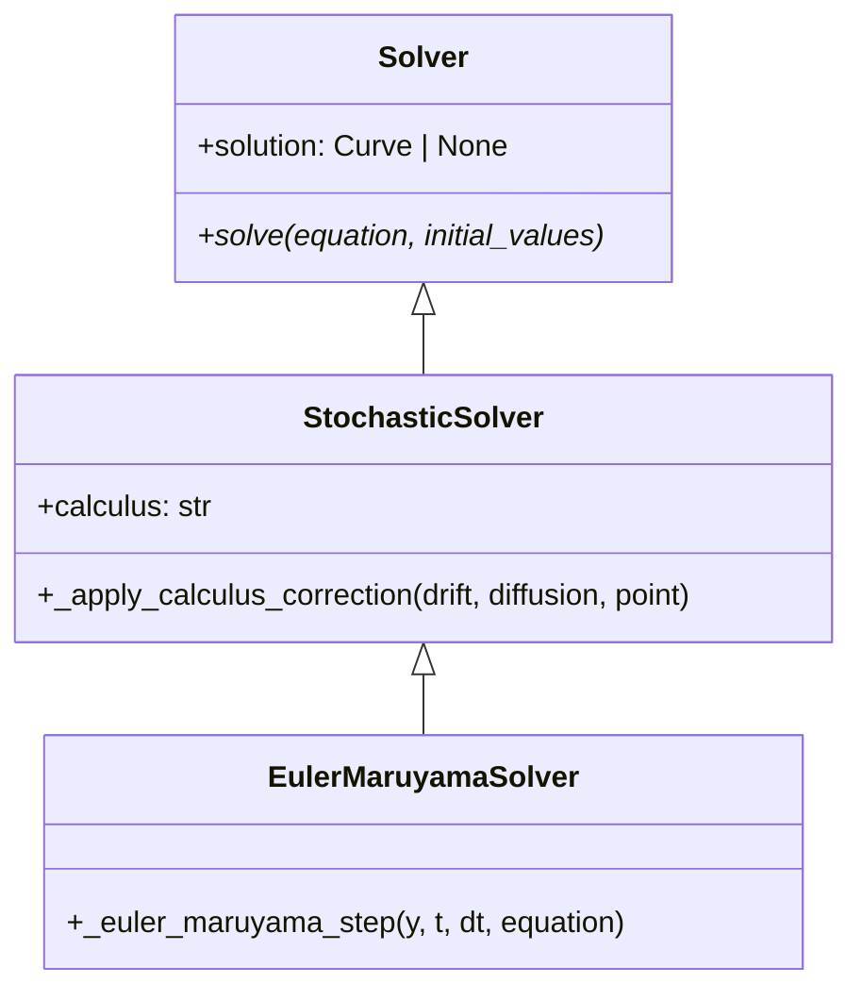
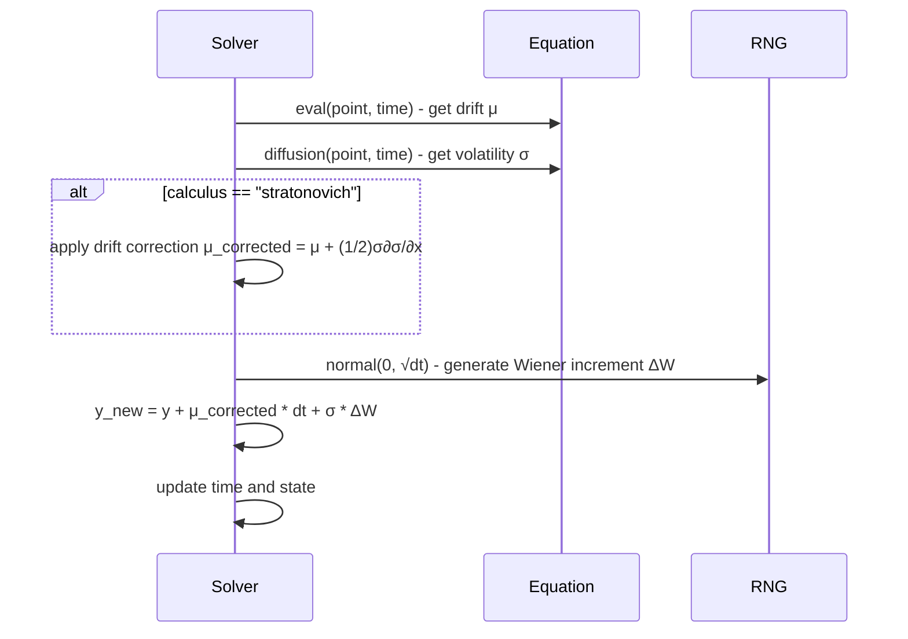

# EULER_MARUYAMA

## Overview

The Euler-Maruyama method is the fundamental numerical algorithm for solving stochastic differential equations (SDEs). It extends the deterministic Euler method to handle stochastic processes by incorporating Wiener increments.

## Architecture

```
EulerMaruyamaSolver
├── Config: start_time, end_time, step_size, random_seed, calculus
├── Method: Explicit Euler with stochastic increments
├── Order: Strong 0.5, Weak 1.0
└── Calculus: Supports Ito and Stratonovich
```

## Executive Summary

**Purpose**: Basic stochastic differential equation solver
**Key Features**: Simple implementation, calculus flexibility, foundation method
**Performance**: Fastest stochastic solver, good for rough approximations
**Use Cases**: Prototyping, educational purposes, baseline comparisons

## Core Classes

### EulerMaruyamaConfig

```python
from discrecontinual_equations.solver.solver_config import StochasticConfig
from discrecontinual_equations.solver.stochastic.euler_maruyama.euler_maruyama_config import EulerMaruyamaConfig

# start_time, end_time, step_size, random_seed and calculus ("ito" by default).
config = EulerMaruyamaConfig(end_time=1.0, step_size=0.25, random_seed=0)
assert isinstance(config, StochasticConfig)
print(config.calculus, config.times.tolist())  # ito [0.0, 0.25, 0.5, 0.75, 1.0]
```

### EulerMaruyamaSolver

```python
from discrecontinual_equations.solver.solver import Solver
from discrecontinual_equations.solver.stochastic.euler_maruyama.euler_maruyama_solver import EulerMaruyamaSolver

# solve(equation, initial_values) returns a Curve. The Stratonovich correction is
# applied by ItoCoefficients (solver/stochastic/coefficients.py).
assert issubclass(EulerMaruyamaSolver, Solver)
```

## UML Class Diagram



## Sequence Diagram - Single Step



## Folder Structure

```
euler_maruyama/
├── __init__.py
├── euler_maruyama_config.py
├── euler_maruyama_solver.py
└── EULER_MARUYAMA.md
```

## Examples

### Basic Brownian Motion

```python
from discrecontinual_equations.differential_equation import DifferentialEquation
from discrecontinual_equations.function.stochastic import StochasticFunction
from discrecontinual_equations.variable import Variable


# dX = μ dt + σ dW (Brownian motion with drift)
class BrownianMotion(StochasticFunction):
    def eval(self, point, time=None):
        return [0.1]  # Constant drift μ = 0.1

    def diffusion(self, point, time=None):
        return [0.2]  # Constant volatility σ = 0.2


x, t = Variable(name="x"), Variable(name="t")
equation = DifferentialEquation(
    variables=[x], time=t, parameters=[],
    derivative=BrownianMotion([x], [], [Variable(name="dx")], t),
)
config = EulerMaruyamaConfig(
    start_time=0, end_time=10, step_size=0.01,
    calculus="ito", random_seed=42,
)

solver = EulerMaruyamaSolver(config)
solver.solve(equation, [0.0])  # Start at 0
```

### Geometric Brownian Motion

```python
# dX = μX dt + σX dW (Black-Scholes model)
class GeometricBM(StochasticFunction):
    def eval(self, point, time=None):
        x = point[0]
        return [0.05 * x]  # Drift: 5% growth

    def diffusion(self, point, time=None):
        x = point[0]
        return [0.2 * x]  # Volatility: 20%


equation = DifferentialEquation(
    variables=[x], time=t, parameters=[],
    derivative=GeometricBM([x], [], [Variable(name="dx")], t),
)
config = EulerMaruyamaConfig(
    start_time=0, end_time=1, step_size=0.001,
    calculus="ito", random_seed=123,
)

solver = EulerMaruyamaSolver(config)
curve = solver.solve(equation, [100.0])  # Start with $100
```

## Functionality Explanation

### Mathematical Foundation

For an SDE `dX = μ(X,t)dt + σ(X,t)dW`, the Euler-Maruyama discretization is:

```
X_{n+1} = X_n + μ(X_n, t_n) Δt + σ(X_n, t_n) ΔW_n
```

Where `ΔW_n ~ N(0, Δt)` is a Wiener increment.

### Convergence Properties

- **Strong Order**: 0.5 - path-wise convergence
- **Weak Order**: 1.0 - convergence of expected values
- **Limitation**: Lower accuracy compared to higher-order methods

### Calculus Support

**Ito Formulation**: Direct discretization of the given SDE
**Stratonovich Conversion**: Automatically applies drift correction for equivalent Stratonovich interpretation

### Random Number Generation

The solver owns `np.random.default_rng(random_seed)` and never touches the global
stream (DEQ-22); a `WienerSource` passed to the constructor replaces the draw, which
is how a convergence study drives every step size with one Brownian path. One
increment is drawn per driver and step.

### Matrix Noise

`diffusion()` may return an `n x m` matrix `G` instead of a vector (DEQ-28): `m`
independent drivers, any coupling between components. The step is then
`y + a dt + G @ dW` with `dW` of length `m`, and nothing else changes - no Levy
areas, no commutativity condition - which is why Euler-Maruyama is the solver the
others name when they refuse a matrix. The vector form is `G = diag(b)` and is
stepped exactly as before. Checked against complex geometric Brownian motion (strong
order measured 0.59, as for the diagonal case) and the stationary covariance of a
rotating Ornstein-Uhlenbeck process with coupled constant noise.

## Algorithm Details

### Single Time Step

```python
import numpy as np


def euler_maruyama_step(y, t, dt, drift, diffusion, generator):
    """One step: drift and diffusion frozen at (t_n, y_n), one N(0, dt) per driver."""
    delta_w = generator.normal(0, np.sqrt(dt), size=len(y))
    return y + np.array(drift(y, t)) * dt + np.array(diffusion(y, t)) * delta_w


# The whole Ito solve by hand: the solver draws from default_rng(random_seed) too,
# so the path is the solver's.
gbm = equation.derivative
generator = np.random.default_rng(123)
y = np.array([100.0])
for t_n in config.times[:-1]:
    y = euler_maruyama_step(y, t_n, config.dt, gbm.eval, gbm.diffusion, generator)
print(y[0] == curve.results[0].discretization[-1])  # True
```

### Stratonovich Correction

```python
def stratonovich_drift(drift, diffusion, y, t, eps=1e-6):
    """The Ito drift of a Stratonovich equation with diagonal noise."""
    dsigma_dx = (np.array(diffusion(y + eps, t)) - np.array(diffusion(y - eps, t))) / (2 * eps)
    # Apply correction: added, never subtracted (DEQ-27)
    return np.array(drift(y, t)) + 0.5 * np.array(diffusion(y, t)) * dsigma_dx


# Read as Stratonovich, the same equation has Ito drift 0.05 x + 0.02 x = 0.07 x.
print(np.round(stratonovich_drift(gbm.eval, gbm.diffusion, np.array([100.0]), 0.0), 6))  # [7.]
strat = EulerMaruyamaSolver(config.model_copy(update={"calculus": "stratonovich"}))
print(f"{strat.solve(equation, [100.0]).results[0].discretization[-1]:.4f}")  # 120.8041, same path
```

## Performance Characteristics

| Aspect | Performance |
|--------|-------------|
| **Computational Cost** | O(1) per step |
| **Memory Usage** | Minimal |
| **Accuracy** | Basic (order 0.5/1.0) |
| **Stability** | Conditionally stable |
| **Parallelization** | Limited by random numbers |

## Error Analysis

### Local Truncation Error
- `O(Δt)` for deterministic part
- `O(√Δt)` for stochastic part
- Combined: `O(Δt^{1/2})` strong convergence

### Global Error
- Strong convergence: `O(Δt^{1/2})`
- Weak convergence: `O(Δt)`

### Bias and Variance
- **Bias**: Systematic error from discretization
- **Variance**: Monte Carlo sampling variance
- **Total MSE**: Bias² + Variance

## References

- Maruyama, G. (1955). "Continuous Markov processes and stochastic equations"
- Kloeden, P.E. & Platen, E. (1992). "Numerical Solution of Stochastic Differential Equations"
- Øksendal, B. (2003). "Stochastic Differential Equations: An Introduction"

---

**Parent Module:** [STOCHASTIC](../STOCHASTIC.md)

**Related Modules:**
- [MILSTEIN](../milstein/MILSTEIN.md) - Higher-order stochastic method
- [SRK2](../srk2/SRK2.md) - Stochastic Runge-Kutta method
