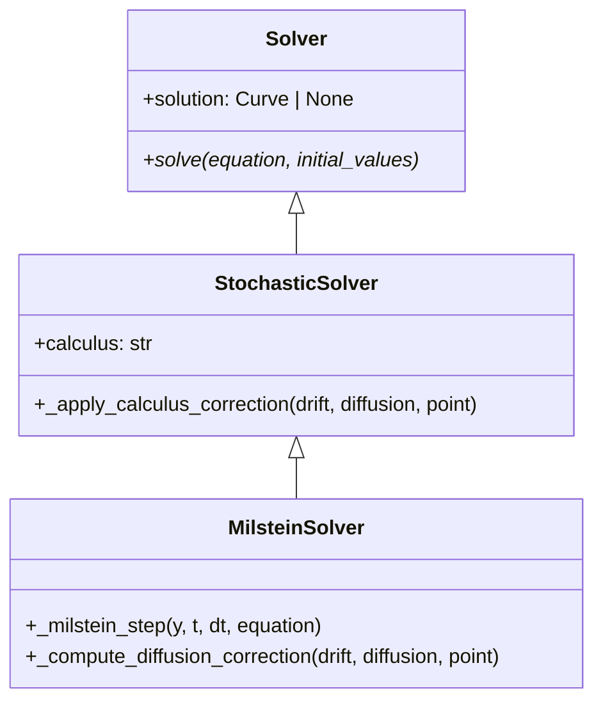
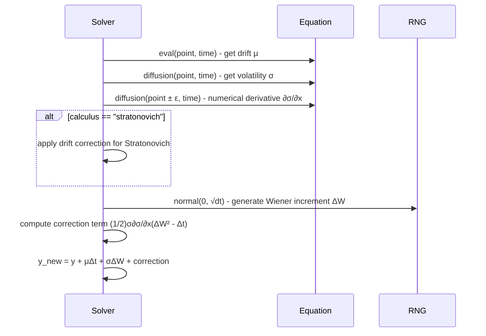

# MILSTEIN

## Overview

The Milstein method is a higher-order numerical algorithm for stochastic differential equations that improves upon Euler-Maruyama by including second-order Ito-Taylor expansion terms. It achieves strong order 1.0 convergence while maintaining computational efficiency.

## Architecture

```
MilsteinSolver
├── Config: start_time, end_time, step_size, random_seed, calculus
├── Method: Ito-Taylor expansion with diffusion correction
├── Order: Strong 1.0, Weak 1.0
└── Calculus: Supports Ito and Stratonovich
```

## Executive Summary

**Purpose**: Higher-accuracy stochastic differential equation solver
**Key Features**: Diffusion correction term, Ito-Taylor expansion, calculus flexibility
**Performance**: Good balance of accuracy and speed for SDEs
**Use Cases**: Financial modeling, systems with multiplicative noise

## Core Classes

### MilsteinConfig

```python
class MilsteinConfig(SolverConfig):
    """Configuration for Milstein method."""

    start_time: float = 0.0
    end_time: float = 1.0
    step_size: float = 0.01
    random_seed: int | None = None
    calculus: Literal["ito", "stratonovich"] = "ito"
```

### MilsteinSolver

```python
class MilsteinSolver(Solver):
    """Milstein method for SDEs with diffusion correction."""

    def solve(self, equation: DifferentialEquation, initial_values: list[float]):
        """Solve SDE using Milstein method."""

    def _milstein_step(self, y, t, dt, equation):
        """Single Milstein step with correction."""
```

## UML Class Diagram



## Sequence Diagram - Milstein Step



## Folder Structure

```
milstein/
├── __init__.py
├── milstein_config.py
├── milstein_solver.py
└── MILSTEIN.md
```

## Examples

### Geometric Brownian Motion

```python
from discrecontinual_equations.solver.stochastic.milstein import MilsteinConfig, MilsteinSolver

# dX = μX dt + σX dW
class GBM(StochasticFunction):
    def eval(self, point, time=None):
        x = point[0]
        return [0.1 * x]  # 10% drift

    def diffusion(self, point, time=None):
        x = point[0]
        return [0.2 * x]  # 20% volatility

config = MilsteinConfig(
    start_time=0, end_time=1, step_size=0.01,
    calculus="ito", random_seed=42
)

solver = MilsteinSolver(config)
solver.solve(equation, [100.0])  # Start at $100
```

### Ornstein-Uhlenbeck Process

```python
# dX = -αX dt + σ dW (mean-reverting)
class OUProcess(StochasticFunction):
    def eval(self, point, time=None):
        x = point[0]
        return [-0.5 * x]  # Mean reversion

    def diffusion(self, point, time=None):
        return [0.3]  # Constant volatility

config = MilsteinConfig(
    start_time=0, end_time=5, step_size=0.001,
    calculus="stratonovich", random_seed=123
)

solver = MilsteinSolver(config)
solver.solve(equation, [1.0])
```

## Functionality Explanation

### Mathematical Foundation

For an SDE `dX = μ(X,t)dt + σ(X,t)dW`, the Milstein discretization includes the Ito-Taylor correction:

```
X_{n+1} = X_n + μ(X_n,t_n)Δt + σ(X_n,t_n)ΔW_n + (1/2)σ(X_n,t_n)∂σ/∂x(X_n,t_n)(ΔW_n² - Δt)
```

The correction term `(1/2)σ∂σ/∂x(ΔW_n² - Δt)` accounts for the diffusion's dependence on the state variable.

### Ito vs Stratonovich

**Ito Milstein**: Uses correction `(1/2)σ∂σ/∂x(ΔW_n² - Δt)`
**Stratonovich Milstein**: Uses correction `(1/2)σ∂σ/∂x ΔW_n²`

The difference arises from the interpretation of stochastic integrals.

### Numerical Differentiation

The derivative comes from `ItoCoefficients.column_jacobians`: central differences
with step `1e-6`, the estimate every stochastic solver shares, so the Stratonovich
drift correction and the Milstein term agree by construction (DEQ-28; before that
this solver carried its own `eps = 1e-8` estimate).

### Systems and Matrix Noise

For `dX = a dt + G dW` with `m` drivers the Milstein term is
`sum_{j,k} (dG_k/dx) G_j I_(j,k)`, with `I_(j,k)` the iterated Ito integral whose
inner index is `j`. Each is `(1/2)(dW_j dW_k - delta_jk dt) + A_(j,k)`, with `A`
the antisymmetric matrix of Levy areas. When the noise *commutes* -
`(dG_k/dx) G_j = (dG_j/dx) G_k` for every pair - the areas cancel and the term is

```
(1/2) sum_{j,k} (dG_k/dx) G_j (dW_j dW_k - delta_jk dt)
```

which is what the solver steps (the `delta_jk dt` left off in the Stratonovich
form), drawing no area and giving the same numbers bit for bit as before DEQ-36.
A vector diffusion is `G = diag(b)`: it commutes when each `b_i` depends only on
`x_i`, and the term is then the per-component `(1/2) b_i b_i' (dW_i^2 - dt)`.
Two-component geometric Brownian motion measures strong order 0.96, and complex
geometric Brownian motion (conformal matrix noise) 0.97 against Euler-Maruyama's
0.59 on the same paths.

When the identity fails, checked at every step, the step adds
`sum_{j,k} (dG_k/dx) G_j A_(j,k)` (DEQ-36; before that the solver raised). The areas
come from the Wiener source when one is given - a `BrownianPath` reads them off its
grid, including the areas inside its cells - and otherwise from a
`LevyAreaSampler` on a stream spawned from `random_seed`, so a seeded run draws
the increments Euler-Maruyama draws. The sampler is Mrongowius and Rossler's
(arXiv:2101.09542): a truncated Fourier series of the Brownian bridge with
`n = ceil(0.092 sqrt(m / dt))` terms, the remainder's `dW`-linear part simulated
exactly and the rest by a Gaussian of the mean conditional covariance; the L2 error
per step is at most `dt^(3/2)`, which keeps strong order 1.0. It costs
`2 m n + m (m + 1) / 2` normals a step, and a warning says so once per solve.

Measured, `dx = -x/2 dt + cos(y) dW_1`, `dy = -y/2 dt + cos(x) dW_2` on `[0, 1]`,
100 paths, against the scheme on the path's own `2^-11` grid:

| dt | Milstein | Euler-Maruyama |
|---|---|---|
| 1/4 | 1.109e-01 | 1.537e-01 |
| 1/8 | 5.672e-02 | 1.173e-01 |
| 1/16 | 2.912e-02 | 7.974e-02 |
| 1/32 | 1.587e-02 | 5.737e-02 |
| 1/64 | 7.768e-03 | 3.921e-02 |
| 1/128 | 3.998e-03 | 2.604e-02 |
| **slope** | **0.96** | **0.51** |

On `dx = dW_1, dy = x dW_2`, where `y(T)` is the iterated integral itself, the
scheme is exact on a path that carries its areas (largest difference 3.8e-11, the
central-difference Jacobians' error) and Euler-Maruyama measures 0.49. Driven by the
sampler the error there is the sampler's alone, below `0.44 dt` for
`dt = 2^-3 ... 2^-10`; its slope is 0.78 on that range, and 0.98 for
`dt = 2^-14 ... 2^-20`. The main cause is the rule's `max(1, ceil(.))`: `n` stays
at 1 for `dt >= 2^-5`, and with `n` fixed the global error goes like `dt^(1/2)`
(while staying far below the bound, `0.07` to `0.21 dt`); order 1.0 needs `n` to grow
like `dt^(-1/2)`, which the ceiling does only in steps. The rest is that for
`n <= 5` the sampler's error falls more slowly than `1 / n`.

### Diagonal Noise and the `diagonal_noise` Declaration

A vector diffusion is stepped from the `n x n` Jacobian of `b` rather than the
`n x n x n` array of products (DEQ-48): the products are `P[j, k] = b_j db_k/dx_j`,
commutativity is "every off-diagonal `|P[j, k]|` within `1e-6` of the largest", and
the term in component `k` is `(1/2) dW_k sum_j P[j, k] dW_j - (1/2) dt P[k, k]`, the
general step to rounding. Reading the Jacobian still takes `2 n` evaluations of `b`
a step, each moving one component.

A function can promise more by setting the class attribute
`diagonal_noise = True` on its `StochasticFunction`: that `diffusion` returns the
vector form and that `b_i` reads `x_i` (and `t`) alone. The solvers then read every
`db_i/dx_i` from two evaluations that move all components at once, so a step costs
three evaluations of `b` whatever `n` is. Measured on one path at `n = 128`
(a loaded machine): 1270 ms a step before DEQ-48, 38 ms found automatically, 1.9 ms
declared. The ensemble and the Stratonovich drift correction of every solver take
the same shortcut.

```python
class IndependentNoise(StochasticFunction):
    diagonal_noise = True  # b_i depends on x_i alone

    def diffusion(self, point, time=None):
        return [0.3 * math.sin(x) + 0.2 * x for x in point]
```

A wrong promise would make a wrong step - `cos(y), cos(x)` declared diagonal falls
from strong order 0.99 to 0.51 - so it is checked once per solve, at the first
state it is used, which is the initial state: the full Jacobian of `b` there,
`1 + 2 n` evaluations. An off-diagonal slope beyond `1e-6` of the largest (or a
NaN) withdraws the declaration with a `UserWarning` naming the function, and that
solve runs exactly as if nothing had been declared, bit for bit. **The check sees
only the initial state:** a `b_i` whose dependence on another component vanishes
there - `x_0 * x_1` started at `x_0 = 0`, say - is not caught and still makes a
wrong step. Declare diagonal noise only when it holds everywhere.

## Algorithm Details

### Single Time Step Implementation

```python
def _milstein_step(self, y, t, dt, equation):
    # Evaluate functions
    drift = np.array(equation.derivative.eval(y, t))
    diffusion = np.array(equation.derivative.diffusion(y, t))

    # Compute diffusion derivative
    dsigma_dx = self._compute_diffusion_derivative(
        lambda p: equation.derivative.diffusion(p, t), y
    )

    # Generate Wiener increment
    dW = np.random.normal(0, np.sqrt(dt), len(y))

    # Milstein correction
    if self.calculus == "ito":
        correction = 0.5 * diffusion * dsigma_dx * (dW**2 - dt)
    else:  # stratonovich
        correction = 0.5 * diffusion * dsigma_dx * dW**2

    # Update state
    y_new = y + drift * dt + diffusion * dW + correction
    return y_new
```

## Convergence Analysis

### Strong Convergence
- **Order 1.0**: `E[|X(t) - X̂(t)|] = O(Δt)`
- **Improvement over Euler-Maruyama**: Reduces path-wise error

### Weak Convergence
- **Order 1.0**: `|E[f(X(t))] - E[f(X̂(t))]| = O(Δt)`
- **Same as Euler-Maruyama** for expected values

### Computational Cost
- **Per step**: 2 function evaluations + derivative computation
- **Total**: O(N) for N time steps
- **Memory**: O(1) additional storage

## Performance Characteristics

| Aspect | Milstein vs Euler-Maruyama |
|--------|---------------------------|
| **Accuracy** | Significantly better (order 1.0 vs 0.5) |
| **Speed** | Slightly slower (extra derivative calculation) |
| **Stability** | More stable for stiff SDEs |
| **Implementation** | More complex (numerical differentiation) |

## Error Analysis

### Local Error
- Deterministic part: O(Δt²)
- Stochastic part: O(Δt^{3/2})
- Combined: O(Δt)

### Global Error Bounds
- Strong: O(Δt)
- Weak: O(Δt)

### Practical Considerations
- **Numerical differentiation** introduces small errors
- **Step size sensitivity** affects derivative accuracy
- **Multi-dimensional** systems with non-commuting noise draw Levy areas every step (see *Systems and Matrix Noise*), per path and in `StochasticEnsemble` alike

## Applications

### Financial Mathematics
- **Black-Scholes model**: Geometric Brownian motion
- **Stochastic volatility**: Heston model components
- **Interest rate models**: CIR process discretization

### Physical Systems
- **Population dynamics**: Logistic growth with noise
- **Chemical reactions**: Stochastic rate equations
- **Neural models**: Membrane potential with channel noise

## References

- Milstein, G.N. (1974). "Approximate integration of stochastic differential equations"
- Kloeden, P.E. & Platen, E. (1992). "Numerical Solution of Stochastic Differential Equations"
- Milstein, G.N. (1995). "Numerical Integration of Stochastic Differential Equations"

---

**Parent Module:** [STOCHASTIC](../STOCHASTIC.md)

**Related Modules:**
- [EULER_MARUYAMA](../euler_maruyama/EULER_MARUYAMA.md) - Basic stochastic method
- [SRK2](../srk2/SRK2.md) - Alternative higher-order method
